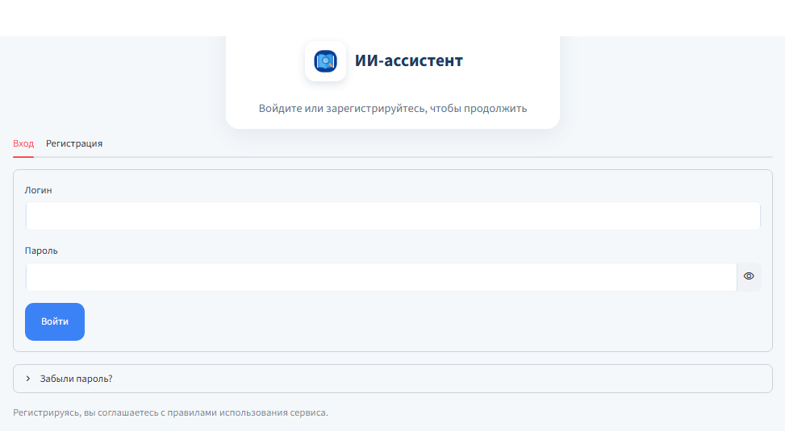
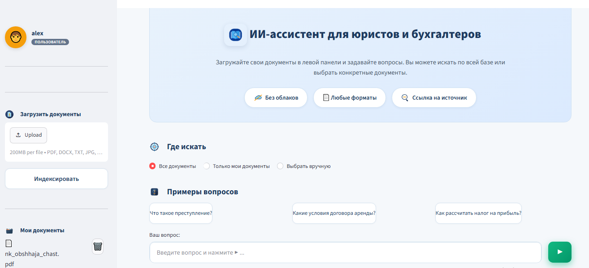
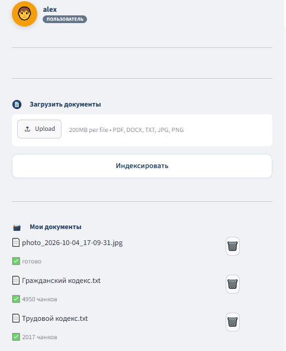
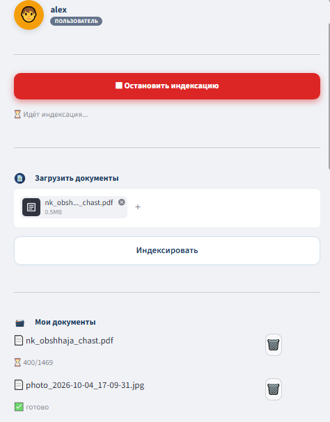
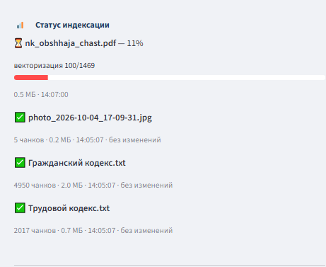
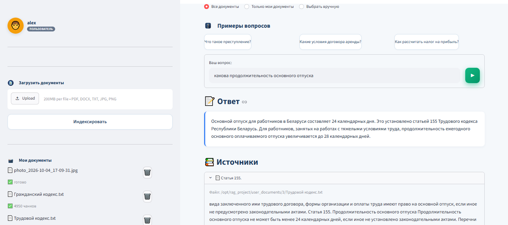
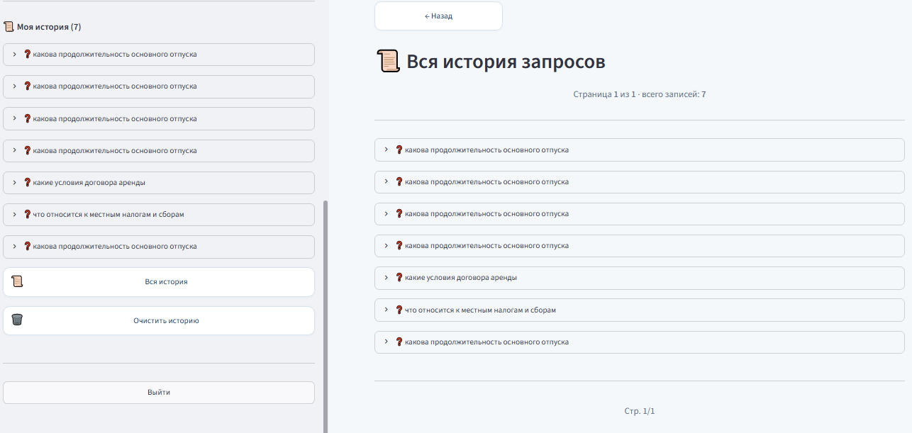

# ⚖️ RAG-ассистент для юристов и бухгалтеров

Приватный ИИ-ассистент, работающий с вашими документами: загружаете PDF/DOCX/TXT/сканы/фотографии — задаёте вопросы на естественном языке — получаете точные ответы с цитатами из источника.

**Полностью on-premise.** Ни одного облачного API. Все данные остаются на вашем сервере.

---

## 🎯 Зачем это

| Проблема | Решение |
|---|---|
| Юрист тратит часы на поиск статьи в кодексе | Спрашивает: «какова продолжительность основного отпуска» → получает ответ за 10 секунд |
| Бухгалтер ищет норму в инструкции | Загружает PDF, задаёт вопрос, получает цитату |
| Сканы и фотографии документов не ищутся | OCR (Tesseract + EasyOCR) распознаёт русский текст с фото |
| Данные нельзя отдавать в облако | Всё крутится на вашем VPS, без интернета |

---

## ✨ Ключевые возможности

### Для пользователя
- 🔐 Регистрация и вход, cookie-сессия на 30 дней
- 📄 Загрузка: **PDF, DOCX, TXT, JPG, PNG** (до 200 МБ)
- 📸 **OCR с фотографий** — фотографируете договор на телефон, загружаете, задаёте вопросы
- 🔍 Семантический поиск + реранкинг (двухэтапный)
- 📝 Ответы с **точными цитатами** и ссылками на источник
- 📊 Прогресс индексации в реальном времени
- ⏹ Возможность остановить индексацию и ▶ продолжить с места остановки
- 📜 История запросов (10 последних + полный список с пагинацией)
- 🗂 Три области поиска: «Все документы / Только мои / Выбрать вручную»

### Для администратора
- 👥 Управление пользователями: список, смена паролей, удаление
- 🔀 Разделение по доменам: `admin.*` для админа, `ai.*` для юзеров
- 💾 Резервное копирование одной командой

### Техническая начинка
- 🧠 Реранкинг через **BGE-reranker-v2-m3** (top-20 → top-5)
- 🎯 **ARTICLE-FILTER**: точный поиск по номеру статьи (payload-индекс)
- 🛡 **Защита от галлюцинаций**:
  - anti-math (вычисления типа «146 - 118 = 28»)
  - anti-fake-article (выдуманные номера статей → авто-замена на правильные)
  - anti-hallucination (числа не из контекста)
  - missing-subjects (слова из вопроса, которых нет в контексте)
- 📋 **Программное извлечение перечня** для вопросов «что относится к...»
- 🔒 HTTPS через Let's Encrypt с автопродлением
- 🚀 Автозапуск через systemd (переживает перезагрузку)

---

## 🏗 Архитектура

**Поток данных:**

1. **Пользователь** → Nginx (HTTPS 443)
2. **Nginx** → Streamlit (127.0.0.1:8501)
3. **Streamlit** → BGE-M3 (векторизация вопроса)
4. **Streamlit** → BGE-reranker-v2-m3 (пересортировка)
5. **Streamlit** → Ollama qwen2.5:14b (генерация ответа)
6. **BGE-M3 / reranker** → Qdrant (хранение и поиск векторов)

**Компоненты:**

| Компонент | Роль | Порт |
|---|---|---|
| Streamlit | UI + RAG-логика | 8501 |
| Ollama | LLM-сервер (qwen2.5:14b) | 11434 |
| Qdrant | Векторная БД | 6333 |
| Nginx | Reverse proxy + SSL | 80, 443 |
| BGE-M3 | Эмбеддинги | — |
| BGE-reranker-v2-m3 | Реранкинг | — |

**RAG-пайплайн:**

1. **Индексация:** загрузка файла → извлечение текста → чанкинг (1500 символов) → извлечение номеров статей → векторизация BGE-M3 → загрузка в Qdrant
2. **Поиск:** векторизация вопроса → ARTICLE-FILTER (если «статья N») → топ-20 кандидатов → реранкинг BGE-reranker-v2-m3 → топ-5 → генерация qwen2.5:14b → постпроверка

**Подробнее:** [docs/architecture.md](docs/architecture.md)

---

## 📸 Скриншоты

### Вход и главный экран

### Сайдбар и индексация

### Результат поиска и история

---

## 🚀 Быстрый старт

Подробно → [docs/deployment.md](docs/deployment.md)

**Минимальные требования:**
- VPS: 12 ядер CPU, 32 ГБ RAM, 200 ГБ SSD
- Ubuntu 24.04 LTS
- Домен с A-записями

**Этапы развёртывания:**
1. Настроить статическую сеть на VPS
2. Установить Docker + Ollama + Qdrant
3. Установить Python-зависимости (torch, FlagEmbedding, streamlit, easyocr, reranker)
4. Загрузить модели: `qwen2.5:14b` (9 ГБ), `BAAI/bge-m3`, `BAAI/bge-reranker-v2-m3`
5. Развернуть приложение в `/opt/rag_project/`
6. Настроить Nginx + Let's Encrypt для HTTPS
7. Настроить systemd для автозапуска

---

## 📊 Метрики производительности

| Задача | Время |
|---|---|
| Индексация 3.8 МБ DOCX (6218 чанков) | ~60 мин на CPU |
| Индексация 0.4 МБ PDF (1869 чанков) | ~15 мин на CPU |
| Ответ LLM (qwen2.5:14b, CPU) | 30–60 сек |
| Поиск в Qdrant (top-20) | <100 мс |
| Реранкинг (top-20 → top-5) | 1–2 сек |
| Загрузка страницы | <500 мс |

**С GPU (RTX 3090):** индексация в 30× быстрее, ответы за 2–5 сек.

---

## 📁 Структура проекта
private-ai-assistant-for-lawyers/
├── README.md
├── LICENSE
├── .gitignore
├── .env.example
├── requirements.txt
├── docker-compose.yml
├── src/
│ ├── app.py
│ ├── auth.py
│ ├── history.py
│ ├── ingest.py
│ ├── ocr.py
│ └── reranker.py
├── infra/
│ ├── nginx-rag.conf
│ ├── streamlit.service
│ └── 10-eth0.network
├── docs/
│ ├── architecture.md
│ ├── deployment.md
│ └── backup-restore.md
└── screenshots/

text

---

## 🧩 Ключевые технические решения

1. **Cookie-сессия** — URL-токен (`?auth=uid:exp.sig`) + `extra-streamlit-components` CookieManager. TTL 30 дней, HMAC-SHA256.

2. **Реранкинг** — Qdrant возвращает 20 кандидатов → BGE-reranker-v2-m3 пересортировывает → топ-5.

3. **ARTICLE-FILTER** — при индексации regex извлекает все номера статей из чанка, сохраняет в payload `article_nums`. При запросе «статья N» — точный фильтр по этому полю.

4. **Anti-hallucination** — 4 уровня защиты: числа из контекста, статьи из контекста, вычисления, субъекты.

5. **Программное извлечение перечня** — для вопросов «что относится к...» regex вырезает список из контекста и вставляет в начало ответа.

6. **Возобновление индексации** — `last_chunk_index` сохраняется в `index_status.json`, кнопка ▶ продолжает с места остановки.

7. **Стоп индексации** — threading.Event + файл-флаг `/tmp/rag_stop_requested` проверяется в батчах.

---

## ⚠️ Известные ограничения

- На очень сложных вопросах qwen2.5:14b может смешивать числа из разных статей одного документа. Частично покрыто anti-math и anti-fake-article.
- Первая индексация большого файла (3+ МБ) на CPU — до часа. С GPU — минуты.
- Модель загружается в память при первом запросе после старта — 5–10 секунд.

---

## 📝 Полный цикл проекта

Демонстрация полного цикла от идеи до продакшена:

1. **Инфраструктура** — развёртывание VPS, статическая сеть, DNS, firewall
2. **Backend** — Python, RAG-логика, работа с векторной БД, реранкинг
3. **Frontend** — Streamlit, кастомный UI/UX, CSS-стилизация
4. **DevOps** — Docker, systemd, Nginx, Let's Encrypt
5. **Security** — изоляция пользователей, HTTPS, cookie-сессии
6. **Documentation** — README + документация
7. **Operations** — мониторинг, бэкапы, восстановление

---

## 📄 Лицензия

MIT

---

## 👤 Автор

**Aleksandr Sokolov** — разработка, дизайн, инфраструктура

---

## 🙏 Благодарности

- [FlagEmbedding](https://github.com/FlagOpen/FlagEmbedding) — эмбеддинги BGE-M3 + BGE-reranker
- [Qdrant](https://qdrant.tech/) — векторный поиск
- [Ollama](https://ollama.com/) — запуск LLM локально
- [Streamlit](https://streamlit.io/) — UI
- [Let's Encrypt](https://letsencrypt.org/) — HTTPS
